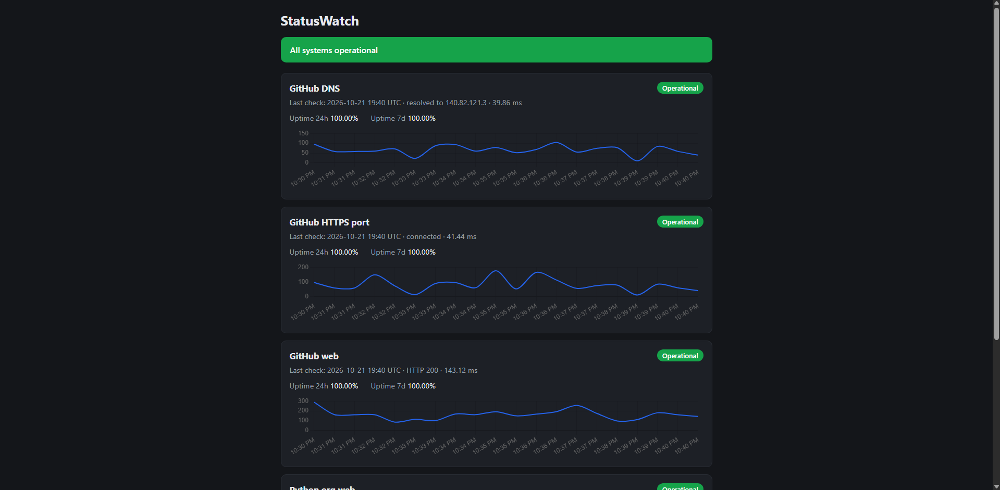
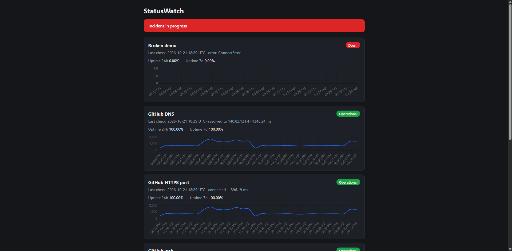
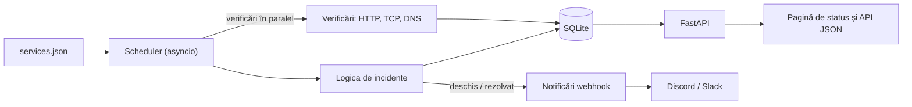

# StatusWatch


Un monitor de servicii ușor, cu pagină de status publică. Verifică ținte HTTP, TCP și DNS după un program, păstrează istoricul, detectează incidentele cu o regulă de filtrare a alertelor false, calculează uptime-ul și trimite o alertă pe Discord când ceva cade și când își revine.

**Demo live:** https://statuswatch-wlzq.onrender.com/  
_(Rulează pe un plan gratuit de hosting: prima vizită după o perioadă de inactivitate poate dura până la un minut, cât se trezește serviciul.)_



## De ce acest proiect

Echipele care operează servicii de rețea și cloud trebuie să știe când se strică ceva, cât a durat căderea și dacă SLA-ul a fost respectat. Am construit StatusWatch ca să exersez, de la cap la coadă, bazele ingineriei de fiabilitate: colectarea semnalelor, transformarea verificărilor brute în incidente, alertarea fără zgomot și livrarea rezultatului cu teste, CI și container.

## Funcționalități

- **Trei tipuri de verificări:** HTTP (cod de status și latență), TCP (timp de conectare la port), DNS (timp de rezolvare)
- **Verificări în paralel**, cu timeout-uri explicite, deci o țintă lentă nu le întârzie pe celelalte
- **Detecția incidentelor:** un incident se deschide după N eșecuri consecutive (implicit 3), începe la primul eșec din serie și se închide la prima verificare reușită
- **Uptime** pe 24 de ore și pe 7 zile
- **Pagină de status publică**, cu banner general, carduri pe serviciu, grafice de latență și tabel de incidente
- **API JSON** pentru aceleași date
- **Alerte** pe un webhook Discord sau Slack, trimise o singură dată la deschiderea unui incident și o dată la rezolvare
- **Configurare fără modificări de cod:** țintele stau în `services.json`, comportamentul se setează prin variabile de mediu
- **Livrare:** Dockerfile (utilizator non-root, health check), docker-compose, GitHub Actions (teste pe Python 3.11 și 3.12, plus un smoke test pe container)

## Capturi de ecran

| Incident în desfășurare               | Alertă în Discord                 |
| ------------------------------------- | --------------------------------- |
|  |  |

## Arhitectură



```
app/
├── checker.py     # verificări HTTP, TCP și DNS, cu un tip de rezultat comun
├── config.py      # încarcă services.json
├── db.py          # stocare SQLite, calcul de uptime, înregistrări de incidente
├── incidents.py   # logica de deschidere / închidere (funcție peste baza de date)
├── scheduler.py   # rulează un ciclu: verifică, salvează, actualizează incidentele, alertează
├── notifier.py    # client de webhook pentru Discord / Slack
├── main.py        # aplicația FastAPI, pagina de status, API-ul JSON
└── templates/     # pagina de status (Jinja2 + Chart.js)
```

## Decizii de design

- **Filtrare înainte de alertă.** Un singur timeout e adesea trecător. Cerând mai multe eșecuri consecutive (configurabil) reduc alarmele false. Incidentul începe totuși la primul eșec, pentru că atunci a început căderea reală.
- **Eșecurile sunt rezultate, nu excepții.** Un serviciu căzut e un rezultat așteptat, deci verificările întorc un obiect de rezultat în loc să arunce excepții. Restul sistemului nu trebuie să știe ce tip de verificare a produs rezultatul.
- **Alertele nu au voie să strice monitorizarea.** Notificatorul își înghite propriile erori și loghează doar codul de status sau tipul erorii, pentru că URL-ul webhook-ului e un secret.
- **Logica de incidente e separată de scheduler.** Citește și scrie doar în baza de date, deci se testează fără acces la rețea și fără timp real.
- **Secretele rămân în afara repo-ului.** URL-ul webhook-ului se citește dintr-o variabilă de mediu.
- **Doar SQL parametrizat**, fără interogări construite prin concatenare de text.

## API

| Endpoint                                 | Descriere                                                               |
| ---------------------------------------- | ----------------------------------------------------------------------- |
| `GET /`                                  | Pagina de status publică                                                |
| `GET /health`                            | Verificare de viață                                                     |
| `GET /api/status`                        | Ultima verificare, uptime (24h, 7z) și incidentul deschis, per serviciu |
| `GET /api/history?service=NUME&limit=50` | Verificările recente pentru un serviciu                                 |
| `GET /api/incidents?limit=50`            | Lista de incidente, cele mai noi primele                                |

Documentația interactivă e disponibilă la `/docs` (FastAPI).

## Rulare locală

```bash
git clone https://github.com/andreeandelia/statuswatch.git
cd statuswatch
python -m venv .venv
source .venv/bin/activate        # Windows PowerShell: .venv\Scripts\Activate.ps1
pip install -r requirements-dev.txt
uvicorn app.main:app --reload
```

Deschide http://127.0.0.1:8000/ și așteaptă primele verificări.

## Rulare cu Docker

```bash
docker compose up --build
```

Istoricul se păstrează într-un volum Docker, iar `services.json` e montat de pe gazdă, deci poți schimba țintele fără rebuild.

## Configurare

| Variabilă                       | Implicit         | Rol                                                                   |
| ------------------------------- | ---------------- | --------------------------------------------------------------------- |
| `STATUSWATCH_SERVICES`          | `services.json`  | Calea către fișierul cu ținte                                         |
| `STATUSWATCH_INTERVAL`          | `30`             | Secunde între cicluri de verificare                                   |
| `STATUSWATCH_FAILURE_THRESHOLD` | `3`              | Eșecuri consecutive care deschid un incident                          |
| `STATUSWATCH_WEBHOOK_URL`       | gol              | Webhook Discord (alertele sunt oprite dacă e gol)                     |
| `STATUSWATCH_WEBHOOK_KIND`      | `discord`        | `discord`                                                             |
| `STATUSWATCH_DB`                | `statuswatch.db` | Calea fișierului SQLite                                               |
| `STATUSWATCH_SCHEDULER`         | `1`              | Pune `0` ca să dezactivezi verificările din fundal (folosit în teste) |

Exemplu de intrare în `services.json`:

```json
{
  "name": "API-ul meu",
  "type": "http",
  "target": "https://example.com/health",
  "expected_status": 200
}
```

## Teste și CI

```bash
python -m pytest -v
```

34 de teste acoperă verificările (cu un transport HTTP simulat și servere TCP locale, deci nu e nevoie de internet), baza de date, regulile de deschidere și închidere a incidentelor, calculul de uptime, scheduler-ul, notificatorul și API-ul. GitHub Actions le rulează pe Python 3.11 și 3.12, apoi construiește imaginea Docker și verifică dacă `/health` răspunde.

## Limitări

- **Stocarea e SQLite pe o singură instanță.** Pe planul gratuit de hosting sistemul de fișiere nu e persistent, deci istoricul se resetează când serviciul repornește sau se redeployează.
- **Uptime-ul e procentul de verificări reușite**, nu o medie ponderată în timp. E corect cât timp intervalul e constant.
- **Fără autentificare sau multi-tenancy.** Pagina de status e publică intenționat, iar țintele se configurează dintr-un fișier.
- **Verificările pornesc dintr-o singură locație.** O implementare reală ar sonda din mai multe regiuni, ca să deosebească o cădere a țintei de o problemă a rețelei locale.
- **Alertele se trimit doar la schimbări de stare.** Nu există remindere pentru incidente lungi și nici escaladare.

## Pași următori

- PostgreSQL pentru istoric persistent
- Sonde din mai multe regiuni
- Detecție de anomalii pe latență, peste istoricul stocat
- Endpoint de metrici pentru Prometheus
- Note pe cronologia incidentelor și ferestre de mentenanță

## Licență

MIT
